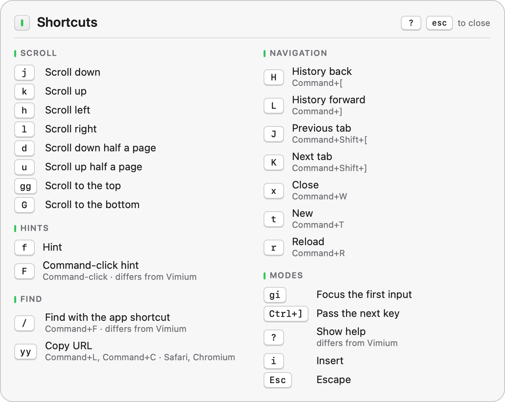

# Supervim

[中文](README.md) · [Download the latest release](https://github.com/lijigang/supervim/releases/latest)

Supervim is a native macOS menu-bar app that brings Vimium's keyboard control to the whole system. Press `f` to label every clickable element in the current window and type a label to click it; scroll with `j` / `k`. It is written in Swift and AppKit, does not use the network while running, and does not record keystrokes.

<picture>
  <source media="(prefers-color-scheme: dark)" srcset="docs/ui-polish/help-dark.png">
  
</picture>

This page is a short version of the [Chinese README](README.md). The documents under [`docs/`](docs/README.md) are mostly in Chinese.

## Install

Requires macOS 13 or later.

1. Download `Supervim-<version>.dmg` from [Releases](https://github.com/lijigang/supervim/releases/latest) and drag `Supervim.app` into Applications.
2. Open it from Applications. The app is not notarized, so macOS blocks the first launch: go to System Settings → Privacy & Security and click Open Anyway. On macOS 14 and earlier you can also right-click the app in Finder and choose Open. If neither works, run `xattr -dr com.apple.quarantine /Applications/Supervim.app` and open it again.
3. Grant the permissions the window asks for, then click `Check Again`. If nothing happens after granting, quit Supervim and open it again.

| Permission | Required | Used for |
| --- | --- | --- |
| Accessibility | Yes | Reading the focus and clickable elements, clicking and scrolling |
| Input Monitoring | Yes | Receiving global key presses |
| Screen Recording | Optional | Only for apps such as WeChat that expose no accessibility elements. It is requested the first time you press `f` in such an app. The capture is used for on-device text recognition; it is not saved or uploaded |

**Updating**: download the new DMG and replace the copy in Applications. Since v0.1.3 every release is signed with the same fixed self-signed certificate, so the permissions you granted survive an upgrade. See [stable signing](docs/stable-signing.md).

## Quick start

Supervim starts in Normal mode. The menu-bar icon shows the mode.

| Mode | Icon | When | Where keys go |
| --- | --- | --- | --- |
| Normal | One block | Default | Keys in the table below are commands; every other key goes to the app |
| Insert | I-beam | Automatically when an input is focused, or after `i` | All keys go to the app, so you type as usual |
| Paused | Two bars | After you pause | All keys go to the app |

Press `Esc` to go from Insert back to Normal. The caret may stay in the field, but keys are commands again, and that field does not re-enter Insert by itself. To type in it again, click it, or press `i` or `gi`.

## Keys

Except for `Esc` and the last row, these keys work only in Normal mode.

| Key | Action |
| --- | --- |
| `f` | Label the clickable elements in the current window; type a label to click it |
| `F` | Same as `f`, but Command-click (for example, open a link in a new browser tab) |
| `j` / `k` | Scroll down / up |
| `h` / `l` | Scroll left / right |
| `d` / `u` | Scroll down / up half a page |
| `gg` | Scroll to the top |
| `G` | Scroll to the bottom |
| `gi` | Focus an input in the window and enter Insert |
| `i` | Enter Insert manually |
| `Esc` | Leave Insert; cancel labels; close help |
| `?` | Open the shortcut sheet; press again to close |
| `/` | Find: sends the app's own `Command+F` |
| `x` | Close: sends `Command+W` |
| `t` | New: sends `Command+T` |
| `r` | Reload: sends `Command+R` |
| `H` / `L` | Back / forward: sends `Command+[` / `Command+]`. Browsers only |
| `J` / `K` | Previous / next tab: sends `Command+Shift+[` / `Command+Shift+]`. Browsers only |
| `yy` | Copy the current URL: sends `Command+L`, then `Command+C`. Browsers only |
| `Ctrl+]` | Pass the next key to the app |
| `Ctrl+Option+V` | Pause / resume Supervim; also works in Insert |

- "Browsers only" means Safari, Chrome, Chromium, Edge, Brave, Arc, and Vivaldi. These keys do nothing in other apps.
- While labels are shown, `Backspace` removes the last typed character; `Esc` or a character that matches no label cancels.
- The two presses of `gg`, `gi`, and `yy` must come within 1 second.
- Scrolling goes to the scrollable area under the mouse pointer. If the pointer is outside the front window (for example on another display), it is first moved to the area being scrolled.
- There are no count prefixes (`3j`), custom keys, omnibar, marks, or visual mode. See [differences from Vimium](docs/vimium-differences.md).

## Menu bar and settings

| Menu item | Action |
| --- | --- |
| Pause / Resume | Same as `Ctrl+Option+V`. The paused state is saved and restored on the next launch |
| Settings | Launch at Login (needs Supervim in Applications) and Excluded Apps |
| Permissions | Shown only while a permission is missing; reopens the permission window |
| Quit Supervim | Quit |

Supervim leaves an excluded app completely alone, including the pause shortcut. Terminal, iTerm2, and Emacs are excluded by default.

## Troubleshooting

| Symptom | Cause and fix |
| --- | --- |
| Keys do nothing | Check the menu-bar icon. Two bars means Paused: choose Resume or press `Ctrl+Option+V`. A Permissions item in the menu means a permission is missing: grant it, click `Check Again`, and reopen Supervim if needed. An excluded app is left alone by design. When Supervim cannot tell whether the focus is editable it passes every key through; click the window content and try again |
| Supervim is on in System Settings but still reports a missing permission | That row belongs to an older build. Select it, remove it with the minus button, then add the current Supervim and turn it on. This is needed once when upgrading from 0.1.2 or earlier |
| Command keys are typed into a field | The focus is in an input, so the mode is Insert. Press `Esc` |
| `f` in WeChat shows no labels and a notice about Screen Recording | WeChat exposes no accessibility elements, so Supervim labels a window capture with on-device text recognition. Turn Supervim on under System Settings → Privacy & Security → Screen Recording, then reopen it. Labels in WeChat take about 1 second; this is a known issue |
| Labels are misplaced with several displays | Update to the latest release (labels are placed per display since v0.1.4). If it still happens, turn on the debug log, press `f` once, and attach the lines starting with `hint-screen`, `hint-panel`, and `hint-label` to an [issue](https://github.com/lijigang/supervim/issues) |

Debug log, off by default. Reopen Supervim after turning it on; the log is `~/Library/Logs/Supervim.log`.

```bash
defaults write com.lijigang.supervim SupervimDebugLog -bool true    # on
defaults write com.lijigang.supervim SupervimDebugLog -bool false   # off
```

## Development

Requires macOS 13+ and Xcode with Swift 6.

```bash
swift build
swift test
scripts/assemble-app.sh     # debug build/Supervim.app
open build/Supervim.app
```

The repository layout is in the [Chinese README](README.md#开发). Packaging, releases, and CI are in [docs/development.md](docs/development.md); the constitution, spec, and plan are listed in [docs/README.md](docs/README.md).
