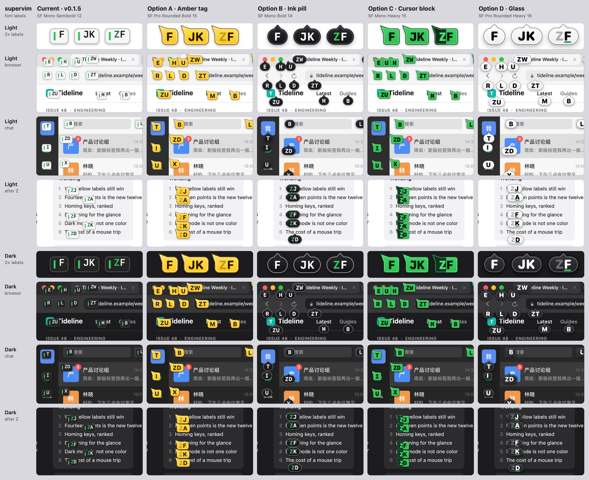
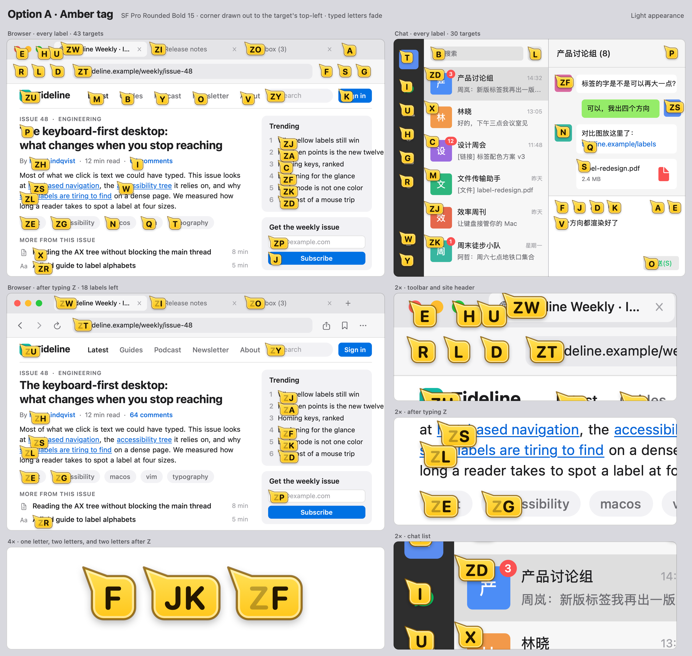
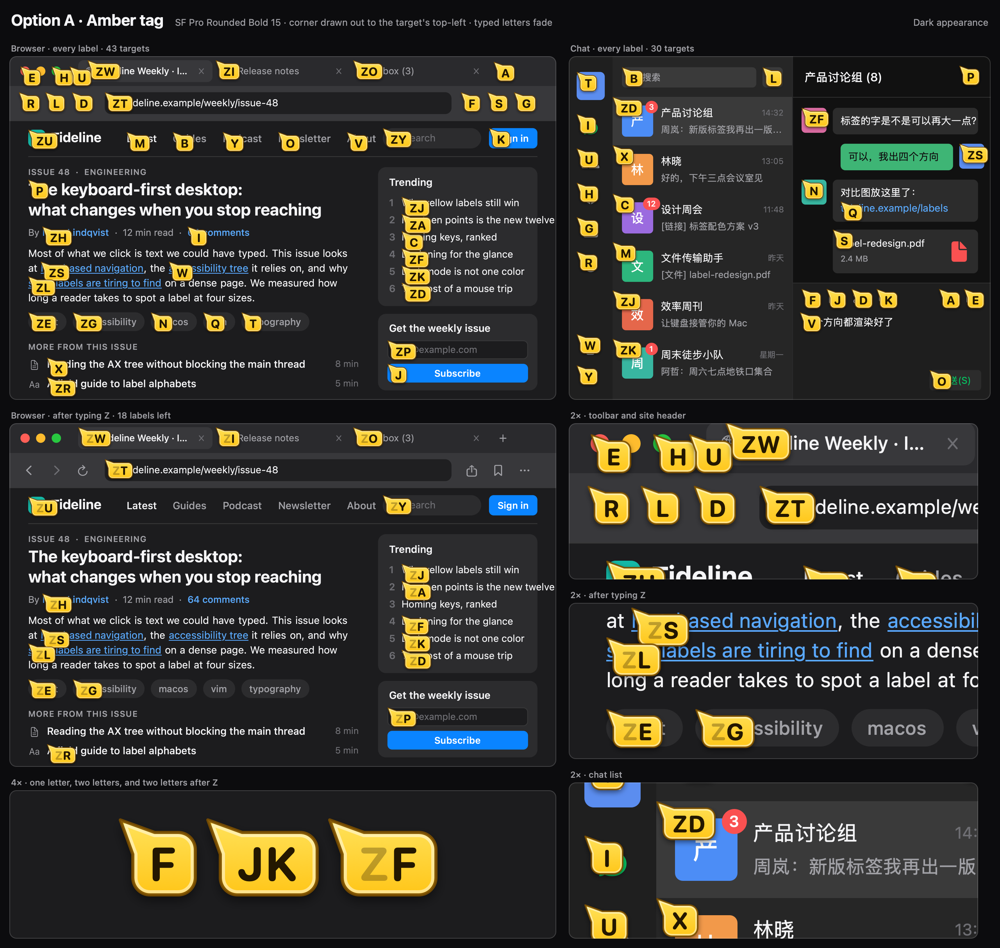
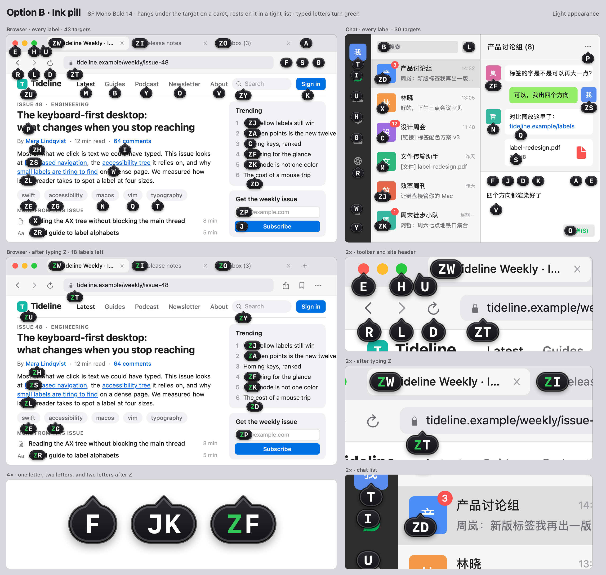
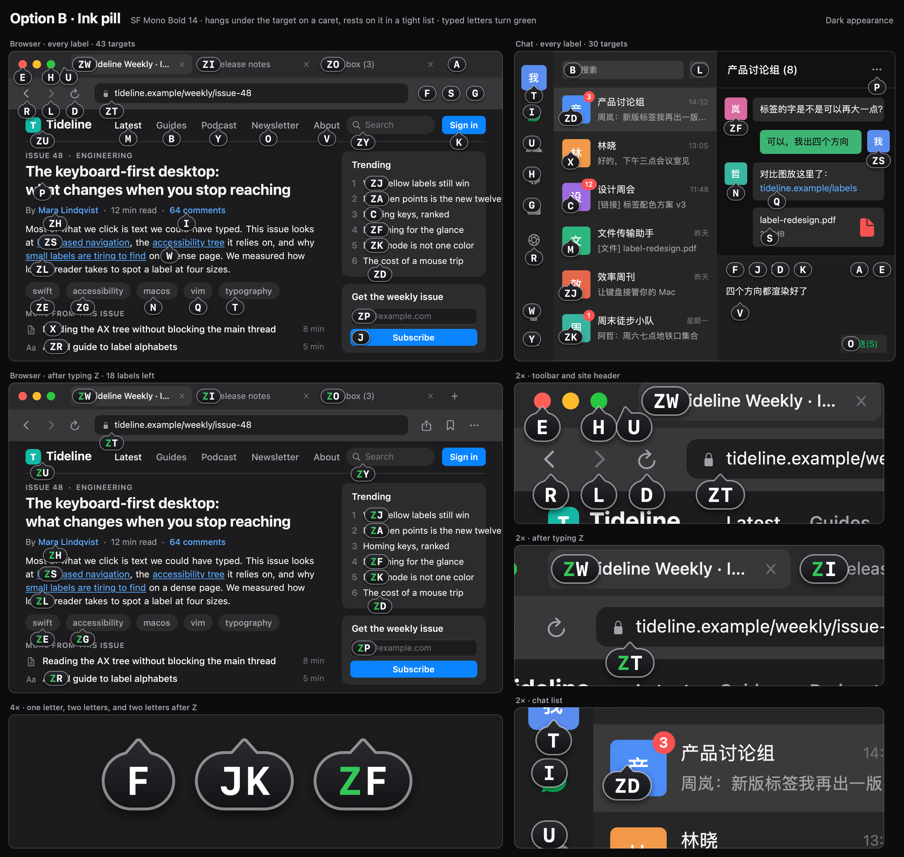
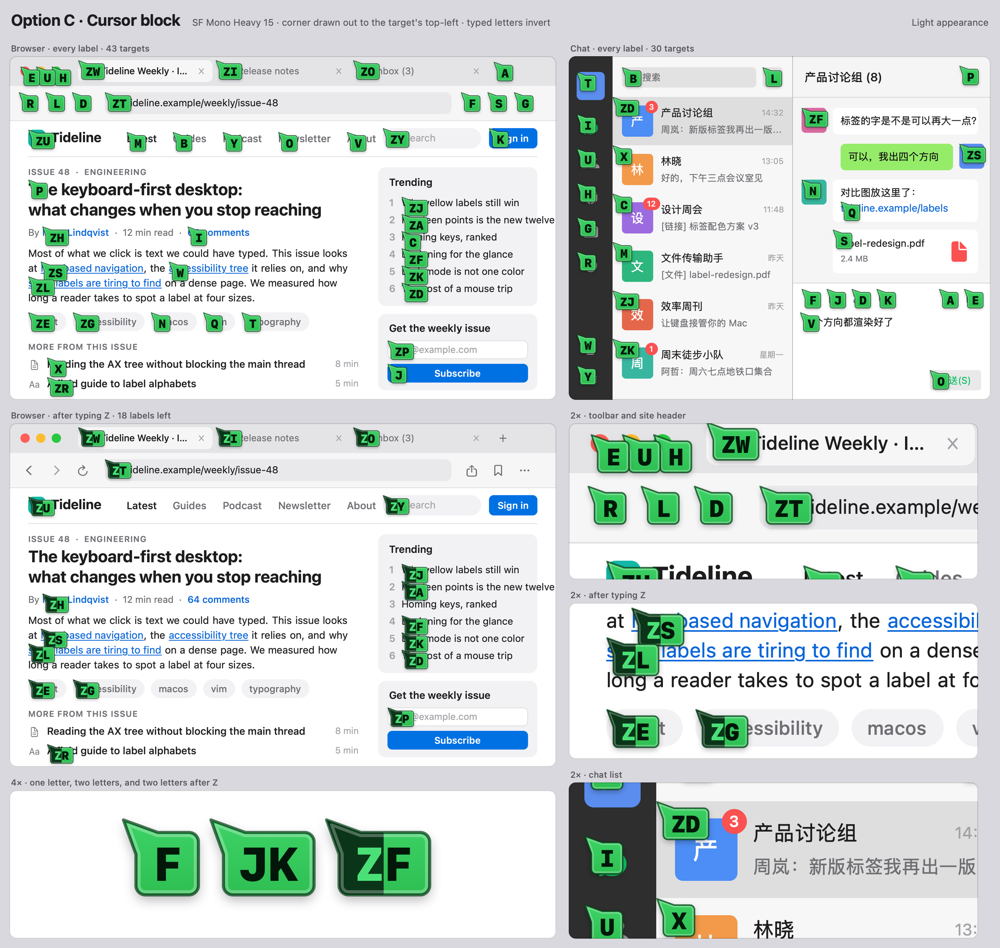
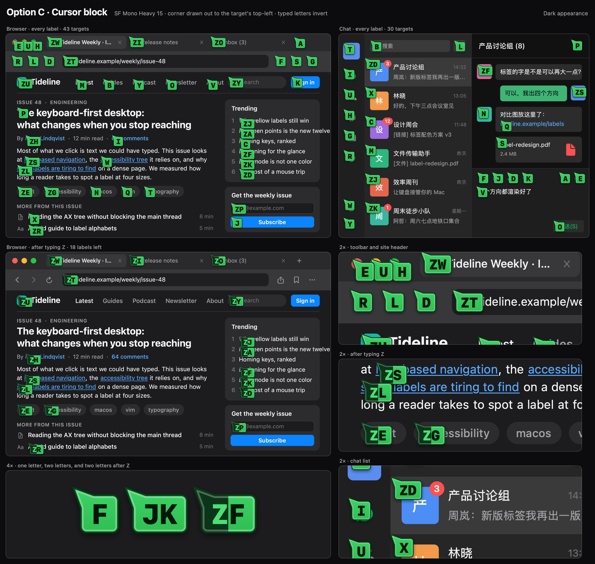
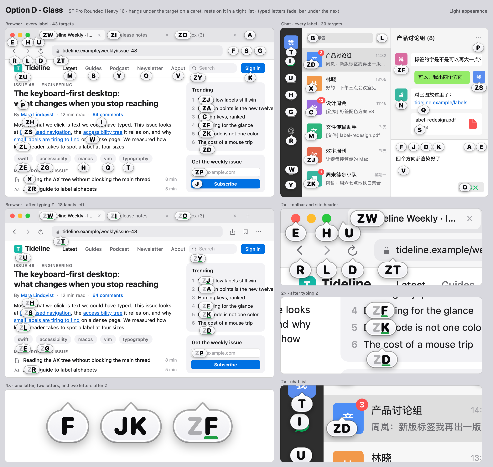
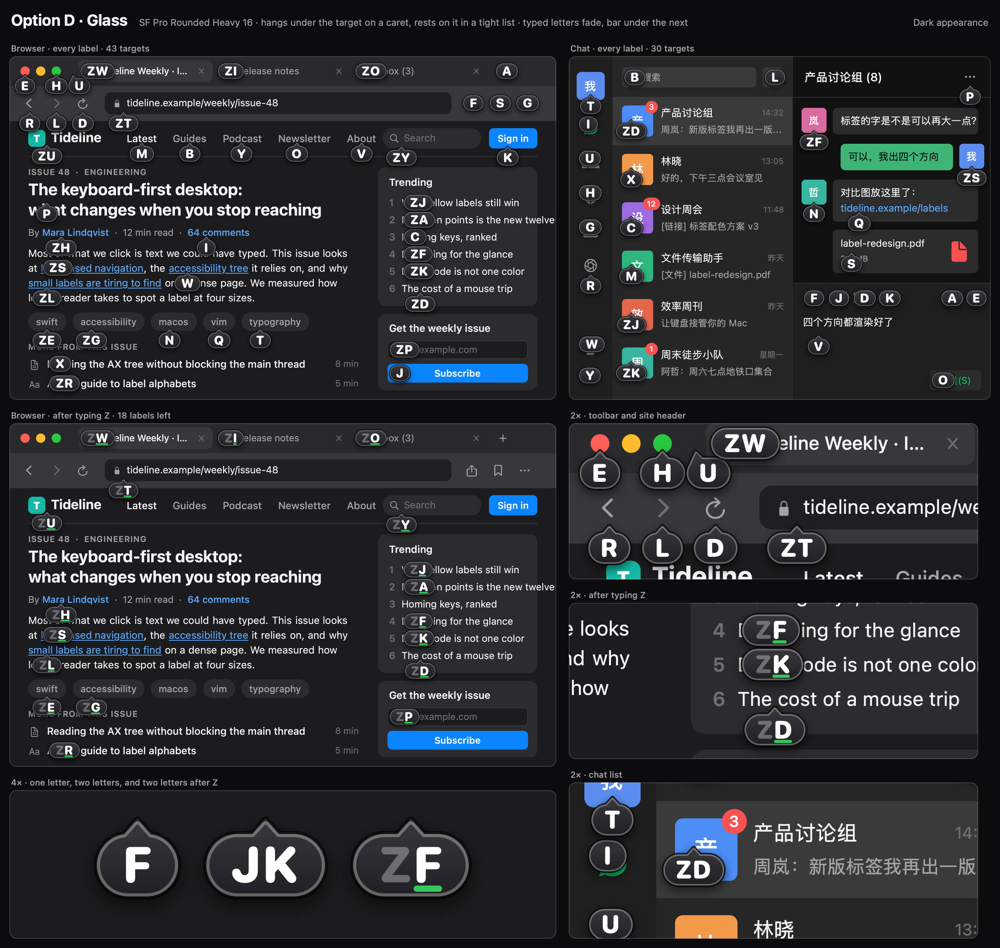

# 提示标签改版：四个方案 / Hint label redesign: four options

状态：第一阶段，只出方案。发布的默认样式没有改，仍是 v0.1.5 的灰底标签（`HintLabelStyle.shipped == .classic`）。四个候选样式已经在真正的视图代码里实现，用一个开关可以在真机上试，但不设开关时界面和 v0.1.5 一样。

Status: phase 1, options only. The shipped default is unchanged: `HintLabelStyle.shipped` is still `.classic`, the gray v0.1.5 label. The four candidates are implemented in the real overlay views behind `HintLabelStyle` and can be tried on a Mac with one setting. Without that setting the overlay draws what v0.1.5 drew.

## 要解决的问题 / The problem

v0.1.5 的标签是 SF Mono Semibold 12，浅灰底、细边，单字母约 24 × 20pt。在真机上的反馈是：不好看，字太小，找标签累。灰底在浅色窗口上和工具栏、输入框是同一类颜色，标签要靠读字才能找到，而不是靠颜色或形状一眼扫到。

The v0.1.5 label is SF Mono Semibold 12 on a light gray pill with a hairline, about 24 × 20pt for one letter. On a real Mac it was judged not good looking and too small, so finding a label is tiring. The gray fill is the same kind of color as toolbars and fields in a light window, so a label is found by reading it, not by its color or shape.

四个方案都满足这几条：

- 字号 14–16pt，Bold 或 Heavy，全大写，SF Mono 或 SF Pro Rounded。
- 要按的字母在每一种底色上、叠在白、黑、黄、蓝、红、绿之上，对比度都不低于 7:1（`HintLabelStyleTests` 里按 WCAG 公式算）。
- 已输入的前缀和还要按的字母一眼能分开，四个方案各用一种办法。
- 标签上有一个指向目标的标记：角或者小尖。
- 整个标签是同一个字体的一行字，键入只改颜色，标签不变宽、字不挪位。
- 字按大写字高在底的正中间排（v0.1.5 的字比底的中线高约 2.5pt）。

All four candidates:

- use 14–16pt Bold or Heavy capitals in SF Mono or SF Pro Rounded;
- keep the letters still to type at 7:1 or better against every fill, over white, black, yellow, blue, red and green (`HintLabelStyleTests` computes it with the WCAG formula);
- separate the typed prefix from the remaining letters at a glance, each in its own way;
- carry a pointer that touches the target: a corner or a caret;
- set the whole label as one line in one font, so typing changes colors only and a label keeps its width;
- center the capitals on the body by cap height (in v0.1.5 the text sits about 2.5pt above the middle).

## 对比 / Side by side



| | 当前 Current | A · Amber tag | B · Ink pill | C · Cursor block | D · Glass |
|---|---|---|---|---|---|
| 字体 Font | SF Mono Semibold | SF Pro Rounded Bold | SF Mono Bold | SF Mono Heavy | SF Pro Rounded Heavy |
| 字号 Size | 12pt | 15pt | 14pt | 15pt | 16pt |
| 字距 Tracking | 0 | 0.4pt | 0.6pt | 0 | 0.5pt |
| 单字母 One letter (F) | 24 × 20pt | 21 × 21pt | 26 × 21pt | 21 × 21pt | 28 × 22pt |
| 双字母 Two letters (JK) | 32 × 20pt | 32 × 21pt | 35 × 21pt | 30 × 21pt | 40 × 22pt |
| 形状 Shape | 圆角 5 | 圆角 6，左上角拉出一个尖 | 胶囊，上方小尖 | 圆角 3.5 的方块，左上角拉出一个尖 | 胶囊，上方小尖 |
| 底色 Fill | `#F7F7F8` / `#242426` | `#FFE25A` → `#FFC619` | `#2A2A30` → `#131316`，96% | `#3DD366` → `#2FBF53` | 浅 `#FFFFFF` → `#EDEDF2`，深 `#38383E` → `#1F1F23`，88% |
| 字色 Text | `#1D1D1F` / `#F5F5F7` | `#231700` | `#FFFFFF` | `#02170A` | 浅 `#0B0B0D`，深 `#FFFFFF` |
| 已输入 Typed | 变绿 green | 淡到 30% fades | 变绿 `#34C759` | 反色：深绿底、亮绿字 inverted cell | 淡到 30%，下一个字母下有绿条 fades, bar under the next |
| 指向 Pointer | 无 none | 角 corner | 小尖 caret | 角 corner | 小尖 caret |
| 位置 Placement | 目标左上角 | 目标左上角 | 目标下方；挤的时候在目标上 | 目标左上角 | 目标下方；挤的时候在目标上 |

尺寸是底的大小，不含阴影用的透明边距；由 CI 上的真字体量出，见 artifact 里的 `metrics.txt`。

Sizes are the body without the clear shadow margin, measured with the real fonts on CI (`metrics.txt` in the artifact).

## 两种指向方式 / Two ways to point

**角（A、C）。** 标签和 v0.1.5 一样压在目标的左上角，外框位置没有变。底的左上角不是圆角，而是拉长成一个尖，尖正好落在目标的左上角上。优点是标签永远在自己的目标上，密集的列表里不会认错；代价是小图标会被盖住，而且行距 22pt 的列表里，下一行标签的尖会压到上一行标签的左下角（见对比图的「after Z」一行）。

**小尖（B、D）。** 标签挂在目标下面，上边一个小三角顶在目标上，图标和文字开头都看得见（Homerow 的做法）。尖在窄目标的正中、宽目标起始 24pt 处；高的行（比如聊天列表的一行）尖最多往下 28pt，所以标签留在这一行里面。屏幕底边放不下时标签翻到目标上面，尖朝下。

挂在下面有一个真问题：紧凑的列表里，一行的下面就是下一行，标签会被看成下一行的。所以规则是：**下面没有别的可点目标时才挂在下面；否则标签落在自己目标的起始处，不画尖。** 包住这个目标的大目标（比如一行里的按钮，行本身也是目标）不算「别的」。键入前缀以后，剩下的标签按整次扫描的目标来判断，所以不会因为邻居消失而跳位置。

结果是同一屏上有两种位置：工具栏、导航、标签页签、聊天行里的标签带尖，列表中间几行和下面紧挨着输入框的一排图标上的标签不带尖、压在目标上（这时图标同样被盖住）。预览图里浏览器侧栏的六行就是这样：前五行压在行首，最后一行下面是空的，挂在下面。

**Corner (A, C).** The label lies on the target's top-left corner as in v0.1.5; its frame does not move. The body's top-left corner is not rounded but drawn out to a point that lands exactly on the target's corner. The label is always on its own target, so a dense list cannot be misread. The cost is that a small icon is covered, and in a list with a 22pt pitch the point of one label overlaps the bottom-left of the label above it (see the "after Z" rows of the comparison).

**Caret (B, D).** The label hangs under the target with a small triangle touching it, so the icon and the start of the text stay visible, as in Homerow. The tip is in the middle of a narrow target and 24pt along a wide one. In a tall row, such as a chat list row, the tip goes at most 28pt down, so the label stays inside the row. At the bottom of a screen the label goes above the target and the caret points down.

Hanging below has one real problem: in a tight list the place under a row is the next row, and the label reads as that row's. So the rule is: **a label hangs below only when no other target is there; otherwise it rests on the leading edge of its own target and has no caret.** A larger target that holds this one, as a row holds its button, does not count as another. After a key the remaining labels are judged against the targets of the whole pass, so they do not jump when their neighbours go away.

So one screen has two placements. Labels on toolbars, navigation links, tags and chat rows have a caret. Labels on the middle rows of a list, and on a row of icons with a text field right under it, have none and lie on the target, where they cover the icon as a corner label would. The six sidebar links of the browser preview show it: five labels rest on the start of their rows, and the last, with nothing under it, hangs below.

## A · Amber tag




Vimium 的黄，收拾干净。

- **字体：** SF Pro Rounded Bold 15，字距 0.4pt。
- **形状：** 圆角 6 的标签，左上角拉成尖，指在目标的左上角。左右内边距 6pt，上下 5pt。
- **颜色：** 底 `#FFE25A` → `#FFC619` 的竖向渐变，不透明；1pt 深琥珀色边 `#7A4E00`（浅色 72%，深色 90%）；内侧一圈 50% 的白色高光；字 `#231700`。浅色和深色外观用同一个黄：标签是靠颜色找的，而页面不会跟着系统变色。
- **已输入：** 已按的字母淡到 30%，剩下的保持近黑。
- **阴影：** 黑 30%（深色 55%），模糊 4pt，下移 1.5pt。

The Vimium yellow, cleaned up. SF Pro Rounded Bold 15 with 0.4pt tracking on a radius-6 tag whose top-left corner is drawn out to the target's corner. Fill `#FFE25A` → `#FFC619`, opaque, with a 1pt dark amber edge `#7A4E00` and a white inner highlight; text `#231700` (11:1 to 13.6:1 across the gradient). The same yellow in light and dark, because a label is found by its color and a page does not change color with the system. Typed letters fade to 30%.

优点：饱和的黄在界面里很少见，是四个里最容易一眼扫到的；深色、浅色、照片上都一样醒目。缺点：最「响」，标签多的时候满屏黄；淡掉的已输入字母靠近底色，只能看出「按过了」，看不清是哪个字母（这是有意的）。

Strength: saturated yellow is rare in interfaces, so this is the easiest of the four to spot, and it is equally loud on light, dark and photos. Weakness: it is the loudest; a screen full of labels is a screen full of yellow. The faded typed letter says "done" but is hard to read, on purpose.

## B · Ink pill




深色胶囊、白字，绿色只用来标已输入。

- **字体：** SF Mono Bold 14，字距 0.6pt。
- **形状：** 胶囊，上方小尖（半宽 4.5pt，高 5pt）顶在目标上。左右内边距 8.5pt，上下 5.5pt。
- **颜色：** 底 `#2A2A30` → `#131316`，96%；浅色外观下 1pt 黑边 60% 加一圈 20% 的白色内高光，深色外观下换成 50% 的白边，这样在深色页面上胶囊仍有轮廓；字纯白。
- **已输入：** 已按的字母变成图标绿 `#34C759`，剩下的保持白色。开启「不以颜色区分」时已输入的字母加下划线。
- **阴影：** 黑 36%（深色 60%），模糊 5pt，下移 2pt。

A dark capsule with white text; green appears only on typed letters. SF Mono Bold 14 with 0.6pt tracking. Fill `#2A2A30` → `#131316` at 96%. In light mode the edge is black at 60% with a faint white inner highlight; in dark mode it is white at 50%, so the pill keeps an outline on a dark page. Typed letters turn the icon green `#34C759` (6.4:1 to 8.4:1 across the gradient); the rest stay white (14:1 to 18.5:1). With Differentiate Without Color the typed letters are also underlined.

优点：白字黑底对比最高；挂在控件下面，工具栏图标都看得见；绿色只出现在「已输入」上，状态很清楚。缺点：在深色窗口里是深色叠深色，只靠白边和阴影分出来，是四个里在深色模式下最不显眼的。

Strength: white on near-black is the highest text contrast, toolbar icons stay visible, and green means exactly one thing. Weakness: on a dark window it is dark on dark and is separated only by its light outline and shadow, so it is the least findable of the four in dark mode.

## C · Cursor block




Supervim 自己的样子：图标里那块绿色的普通模式光标，直接当标签。

- **字体：** SF Mono Heavy 15，字距 0。
- **形状：** 圆角 3.5 的方块，像终端里的块状光标；左上角拉成尖。左右内边距 5.5pt，上下 4.75pt。单字母是 21 × 21pt 的正方块。
- **颜色：** 底 `#3DD366` → `#2FBF53`，不透明；1pt 深绿边 `#063D17`（浅色 70%，深色 90%）；28% 白色内高光；字 `#02170A`（近黑，7.7:1 到 9.5:1）。用黑字不用白字：白字在这个绿上只有 2.0:1 到 2.4:1。浅色、深色同一个绿。
- **已输入：** 已按的那一格反色——底变深绿 `#0A3518`，字变亮绿 `#4BE077`——像光标已经走过去。
- **阴影：** 同 A。

Supervim's own look: the green normal-mode cursor block of the app icon used as the label. SF Mono Heavy 15 on a radius-3.5 block with the top-left corner drawn out to the target. Fill `#3DD366` → `#2FBF53`, opaque, with a dark green edge `#063D17`. The text is near-black `#02170A` (7.7:1 to 9.5:1), not white: white on this green is only 2.0:1 to 2.4:1. The typed cell inverts to bright green `#4BE077` on dark green `#0A3518` (8:1), as if the cursor had moved past it.

优点：和图标、菜单栏、帮助页是一家；已输入的反色格是四个里最清楚的。缺点：绿色在界面里很常见（微信的强调色、发出的气泡、「完成」按钮），标签叠在绿色上时不如黄色跳；等宽 Heavy 字比圆体稍硬。

Strength: it belongs with the icon, the menu bar glyph and the help sheet, and the inverted typed cell is the clearest of the four. Weakness: green is common in interfaces (WeChat's accent, sent bubbles, "Done" buttons), so on green content it stands out less than yellow.

## D · Glass




跟着系统外观走的半透明胶囊，字最大最重。

- **字体：** SF Pro Rounded Heavy 16，字距 0.5pt。
- **形状：** 胶囊，上方小尖。左右内边距 9pt，上下 5pt。
- **颜色：** 浅色外观：底 `#FFFFFF` → `#EDEDF2`，88%，1pt 黑边 30%，内侧 90% 白色高光，字 `#0B0B0D`。深色外观：底 `#38383E` → `#1F1F23`，88%，黑边 60%，30% 白色内高光，字纯白。
- **已输入：** 已按的字母淡到约 30%，下一个要按的字母下面有一条 2pt 的绿条（浅 `#1E9E44`，深 `#34C759`）。
- **阴影：** 四个里最大：黑 30%（深色 60%），模糊 7pt，下移 2.5pt，靠它把标签从页面上托起来。

A translucent capsule that follows the system appearance, with the largest and heaviest letters: SF Pro Rounded Heavy 16 with 0.5pt tracking. Light: fill `#FFFFFF` → `#EDEDF2` at 88%, black edge at 30%, strong white inner highlight, text `#0B0B0D`. Dark: fill `#38383E` → `#1F1F23` at 88%, black edge at 60%, text white. Typed letters fade to about 30% and a 2pt green bar sits under the next letter to press. The shadow is the largest of the four and is what lifts the label off the page.

优点：最像 macOS 自带的东西，最安静，字最大。缺点：白底标签在白页面上只靠边和阴影，比有颜色的标签难扫到；标签最大，占地方最多。这里的「玻璃」是 88% 的半透明底，没有背景模糊——标签画在一张透明画布上，要模糊就得每个标签一个 `NSVisualEffectView`，上百个标签时太重。「减少透明度」或「提高对比度」打开时底变成不透明。

Strength: it looks the most like something macOS ships, it is the quietest, and it has the largest letters. Weakness: a white label on a white page is carried by its edge and shadow only, so it is harder to spot than a colored one, and it is the largest label. "Glass" here is an 88% translucent fill without backdrop blur: all labels are drawn on one transparent canvas, and real blur would need one `NSVisualEffectView` per label, which is too heavy for a few hundred labels. With Reduce Transparency or Increase Contrast the fill is opaque.

## 我的建议 / Recommendation

如果反馈的核心是「找标签累」，选 **A**。找标签靠的是颜色先于形状、形状先于读字；饱和的黄是唯一一个在浅色窗口、深色窗口、微信的绿和照片上都不会和内容混在一起的颜色，而且标签始终压在自己的目标上，不需要判断它属于上面还是下面。想要更安静、更像系统的外观，选 **D**。B 在深色模式下不够显眼，C 在绿色内容上不够显眼（微信正好是绿的），我不建议它们做默认，但可以留作可选样式。

If the complaint is that finding labels is tiring, pick **A**. A label is found by color before shape and by shape before reading; saturated yellow is the one color here that does not blend with a light window, a dark window, WeChat's green or a photo, and the label is always on its own target, so there is nothing to decide about above or below. For a quieter, more native look pick **D**. B is weak in dark mode and C is weak on green content, which WeChat is; I would not make either the default, though they can stay as choices.

## 在真机上试 / Trying one on a Mac

候选样式不是默认，但可以打开：

```sh
defaults write com.lijigang.supervim SupervimHintLabelStyle amber   # 或 ink、cursor、glass，或 A–D
# 退出并重新打开 Supervim
defaults delete com.lijigang.supervim SupervimHintLabelStyle        # 回到默认
```

The setting is read once when the overlay is first made, so quit and reopen Supervim after changing it. Any other value, or no value, is the shipped style.

## 预览图怎么来的 / How the previews are made

`docs/label-redesign/` 里的 PNG 由 macOS CI 画出（`label-previews` 任务，`scripts/render-label-previews.sh`），不是设计稿：

- 背景是 `Tools/LabelPreviews` 里用 AppKit 画的两个假窗口：一个浏览器（标签栏、工具栏、站点导航、带行内链接的文章、标签、紧凑的侧栏列表、表单），一个微信式的聊天客户端（图标栏、会话列表、对话、输入区）。里面的名字、网址和消息都是编的。
- 可点的目标和画出来的东西是同一遍代码记下来的，再交给应用自己的 `HintRanking` 排序、`HintSession` 起名、`HintOverlayLayout` 定位，最后由浮层用的同一个 `HintCanvasView` 画出来。少的只是那个窗口。
- 字体是 CI 机器上的 SF Mono 和 SF Pro Rounded。
- 每个方案一张浅色、一张深色（2560 × 2428 像素，2 倍）：两个窗口的全部标签，浏览器按下 `Z` 之后的状态，三条 2 倍放大，一条 4 倍放大的标签样本。
- 提交在这里的文件和 artifact 里的逐像素相同，只用 `optipng -o2 -strip all` 无损重压了一遍，小了约四分之一。artifact 里另有 `current-light.png`、`current-dark.png`（v0.1.5 的样式，同样的画法）和 `metrics.txt`，没有提交。

The PNGs in `docs/label-redesign/` come from the `label-previews` CI job on macOS (`scripts/render-label-previews.sh`). The backgrounds are two mock windows drawn with AppKit in `Tools/LabelPreviews`: a browser on an article page and a WeChat-like chat client. Every name, address and message in them is made up. The targets are recorded by the same code that draws them, then ranked by `HintRanking`, named by `HintSession`, placed by `HintOverlayLayout` and drawn by the overlay's own `HintCanvasView`, with the SF fonts of the CI machine. Only the panel window is missing.

Each option has a light and a dark sheet (2560 × 2428 pixels, 2x): both windows with every label, the browser after `Z` is typed, three strips at twice the size and three labels at four times the size. The committed files are pixel for pixel the artifact's, recompressed losslessly with `optipng -o2 -strip all`, which makes them about a quarter smaller. The artifact also holds `current-light.png` and `current-dark.png` (the v0.1.5 style drawn the same way) and `metrics.txt`; those are not committed.

- `docs/label-redesign/compare.png`
- `docs/label-redesign/option-A-light.png`、`docs/label-redesign/option-A-dark.png`
- `docs/label-redesign/option-B-light.png`、`docs/label-redesign/option-B-dark.png`
- `docs/label-redesign/option-C-light.png`、`docs/label-redesign/option-C-dark.png`
- `docs/label-redesign/option-D-light.png`、`docs/label-redesign/option-D-dark.png`

## 没核对的事 / What was not checked

- 没有在物理 Mac 上看过这四个样式。颜色、字重、阴影以 CI 的离屏 PNG 为准；真实屏幕上的观感（尤其是黄和绿的饱和度、阴影的轻重）要在真机上用上面的开关确认。
- 假窗口不是真应用。真实的无障碍树里目标的大小和层级更乱，「下面有没有别的目标」这条规则在真应用里的效果只有 `HintLabelStyleTests` 里的几何测试和这两张假窗口作证。
- 第一阶段没有改默认样式，也没有改 `HintGeometry.labelRect` 和 v0.1.5 的绘制代码；`classic` 的落点由测试钉住，和原来的流程逐项相等。

None of the four was seen on a physical Mac. Colors, weights and shadows are judged from offscreen PNGs; how saturated the yellow and the green feel on a real display, and how heavy the shadows are, should be confirmed with the setting above. The mock windows are not real apps: a real accessibility tree is messier, and the "is another target under it" rule is backed only by the geometry tests in `HintLabelStyleTests` and these two mock windows. Phase 1 does not change the default, `HintGeometry.labelRect`, or the v0.1.5 drawing code; a test pins the `classic` arrangement to the old pipeline item for item.
